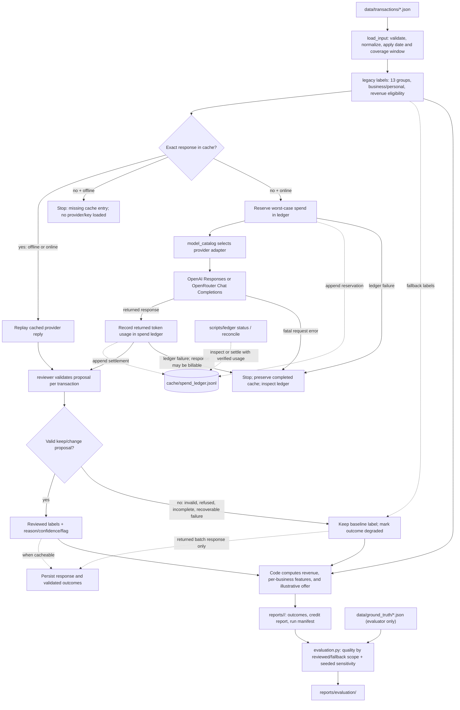

# Architecture

## Scope

A deterministic Python batch pipeline for synthetic, Plaid-shaped transactions. It is an evaluation tool, not a production underwriting system. Ground truth is isolated from the reviewer and read only by the evaluator.

The main review CLI does not load ground truth. In online mode it reserves the budget before a cache-miss provider request and settles from returned usage; a fatal request/ledger error stops the run. Recoverable or unusable item responses retain baseline labels as degraded outcomes. Cache persistence is conditional: failed transports are not cached, while returned batch responses (including degraded ones) are retained for replay/diagnosis. Offline mode uses only exact cache entries and fails explicitly on a miss. The evaluator is a separate command and joins the saved outcomes to the separate synthetic truth.

## Repository inputs and outputs

| Path | Role |
|---|---|
| `data/transactions/` | Reviewer input fixtures; no truth labels |
| `data/ground_truth/` | Evaluator-only expected labels; never passed to a provider |
| `tests/fixtures/` | Small input-shape and offline replay fixtures |
| `cache/batch_reviews.jsonl` | Active main-cohort response cache (currently partial) |
| `cache/spend_ledger.jsonl` | Main OpenAI reservation/settlement ledger |
| `scripts/ledger` | Inspect and reconcile reservations using provider-confirmed token usage |
| `cache/experiments/` | Historical trial caches and provider-specific ledgers |
| `reports/main/`, `reports/evaluation/` | Selected cohort outputs and truth-based analysis |
| `reports/new_input/` | Complete small offline replay example |
| `reports/experiments/` | Prior pilots; not main-run evidence |
| `scripts/run` | CLI launcher; sets source path and loads `.env` only for explicit online mode |

## Boundaries

- **Code owns:** input validation, signed amount interpretation, 13-group precedence, revenue eligibility, feature formulas, offer calculation, cache identity, and output validation.
- **Model proposes only:** keep/change, group, business/personal, confidence, and a short reason. It cannot edit transaction facts, revenue, features, or offer.
- **Failure behavior:** invalid, incomplete, refused, or recoverable provider failures retain the baseline label and are marked degraded. Hosted adapters classify exhausted quota, long server-requested cooldowns, and non-rate-limit OpenAI/OpenRouter request errors as fatal; the CLI stops before sending later batches, preserving completed cache entries for resume. Spend-ledger reservation errors stop before a provider call; settlement errors stop after the response and require ledger reconciliation before retrying. Failed transport calls are not cached. OpenRouter also stops after a degraded response. An uncached offline request fails instead of pretending it was reviewed and exits through a concise CLI error. The launcher does not load `.env` for offline mode.
- **Progress logging:** individual provider requests/completions, periodic offline replay milestones, and batch progress go to stderr; the final machine-readable run summary stays on stdout. Logs omit transaction IDs, descriptions, credentials, and provider error text.
- **Artifact writes:** CLI/evaluation/pilot JSON reports and regenerated fixture files are written to same-directory temporary files and atomically replaced, so interruption during serialization cannot leave a truncated destination. CLI/evaluation report writers and the synthetic fixture generator serialize multi-file output-set replacement with a local advisory lock; each file remains individually atomic rather than a filesystem-wide transaction, so the evaluator checks report hashes against the manifest to detect mixed or modified artifacts. Hidden runtime lock files are gitignored; these locks are not distributed across hosts/filesystems.
- **Append-only records:** cache and spend-ledger readers discard and truncate only a final JSONL fragment missing its newline, then retain strict integrity checks for every complete record. This lets a resumed run recover from a process interruption without concealing corruption in committed records. `scripts/ledger status` lists only safe reservation metadata; `reconcile` settles a stranded reservation only with provider-confirmed token counts and never releases an uncertain hold.
- **Safety:** descriptions are untrusted JSON data; the provider has no tools. Structured output is checked again in application code.
- **Reproducibility and cost tracking:** the input and evaluator truth SHA-256 values are captured from the exact bytes parsed, so later file changes cannot make a long-running report claim a different source. The manifest also records model/provider, versioned prices, usage, statuses, and output hashes; cache entries hash model/prompt/schema/input identity and OpenRouter model/response-format routing (legacy OpenAI keys remain compatible); sidecar advisory locks serialize local cache and spend-ledger JSONL operations. They are not distributed locks across hosts or network filesystems.

## Main modules

| Module | Responsibility |
| --- | --- |
| `data.py`, `synthetic.py` | Plaid-shaped validation and deterministic synthetic fixtures |
| `legacy.py`, `revenue.py` | Keyword labels and code-derived revenue eligibility |
| `reviewer.py`, `provider.py` | Prompt/schema validation, explicit individual/batch protocols, adapter factory, transport, and degraded fallback |
| `model_catalog.py` | Approved model IDs, provider routing, API-key environment names, versioned prices, and model API/JSON capabilities |
| `cache.py` | Integrity-checked replay cache and conservative spend ledger; pricing is read from the catalog |
| `credit.py` | Per-business feature and illustrative offer calculations |
| `cli.py` | Online cache fill or offline cache replay; default output is `reports/main/` |
| `evaluation.py` | Separate truth-based quality by model/fallback scope and seeded sensitivity reports |
| `pilot.py` | Historical OpenAI prompt experiments; not the production/main CLI |
| `local_pilot.py` | Separate Ollama diagnostic path; Ollama is not currently a hosted-review adapter |

The CLI and OpenAI prompt pilot both use `provider.create_provider()`, which routes using `model_catalog.py` rather than parsing model-name prefixes. Pricing, API-key environment names, API model IDs, and model-specific JSON response modes are catalog metadata, so adding a model for an existing provider does not require edits to CLI/cache routing or scattered model-name checks. OpenAI and OpenRouter implement separate transport adapters over shared review/batch methods; the batch capability is an explicit protocol, not a duck-typed `hasattr` check. A genuinely new hosted provider still needs an adapter and a factory mapping; provider-specific protocol behavior remains in its adapter. Ollama remains a diagnostic-only path and cannot be selected for the main review pipeline.

## Current delivery limitation

The main cohort contains 2,000 rows: 799 valid model proposals, one invalid response, and 1,200 provider failures. These last two categories produce **1,201 degraded outcomes** that retain legacy labels; 800 rows are represented in the 10 cached batches. OpenAI returned organization-level 100k TPM errors on both configured keys. Thus the report is complete as an **outcome/fallback snapshot**, but the model cache and no-key replay are partial. See [`../SOLUTION.md`](../SOLUTION.md).
